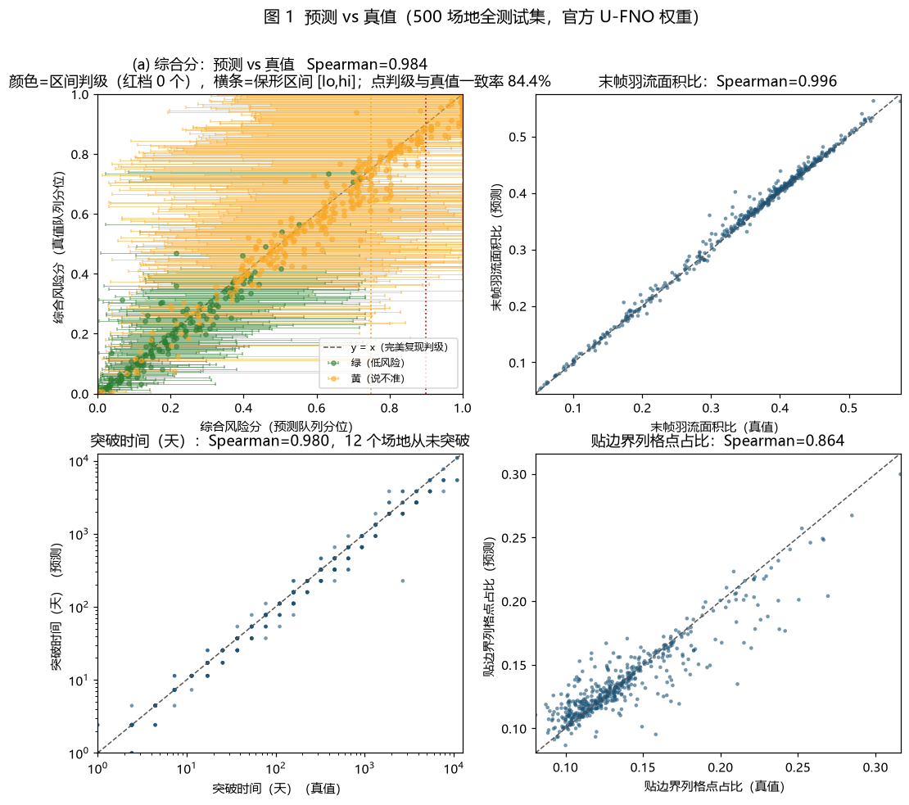
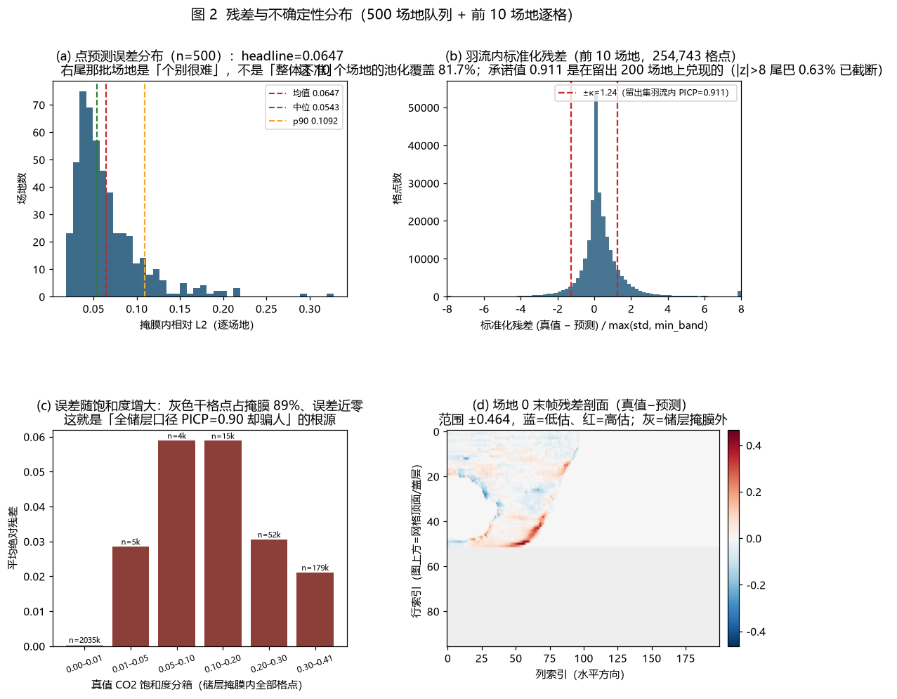
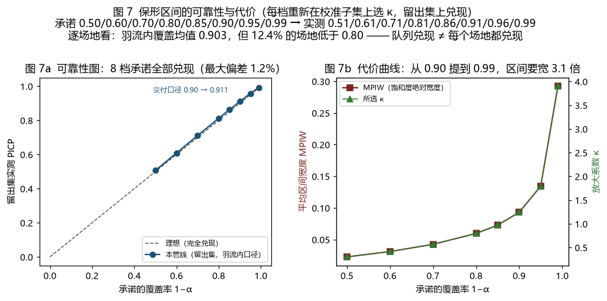
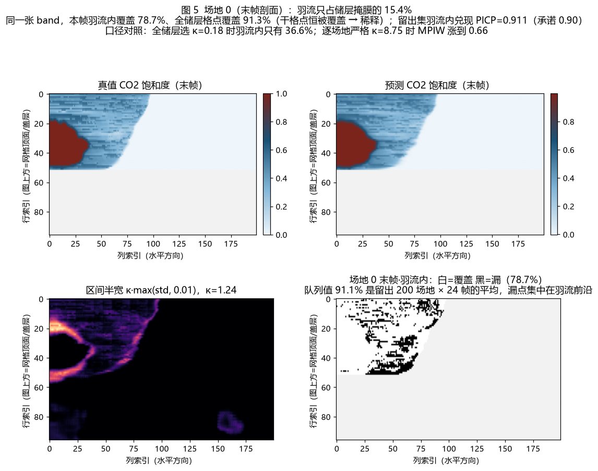
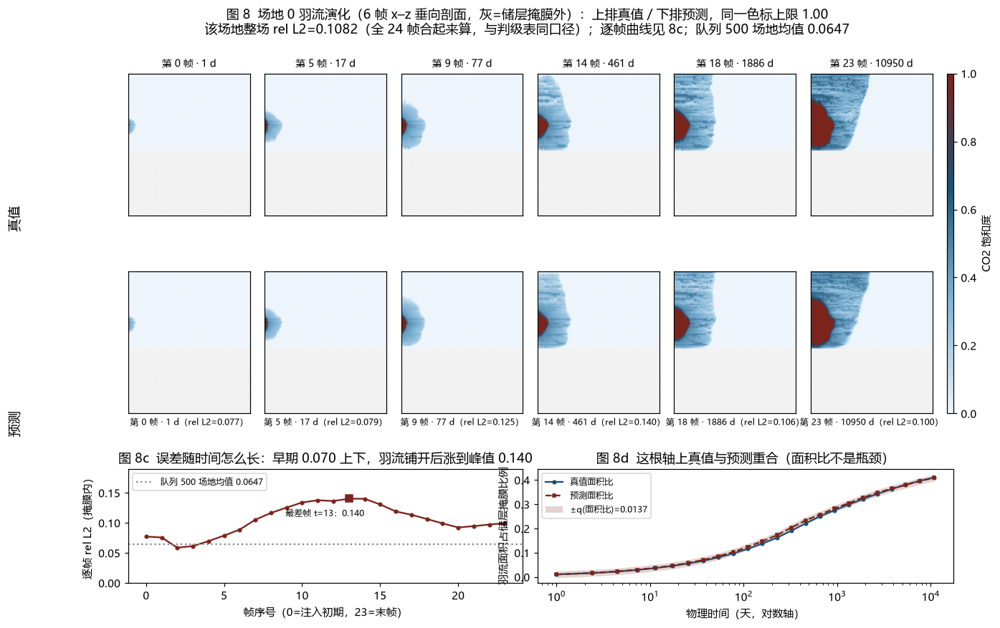

# CCUS-AI-Surrogate · 面向 CO₂ 地质封存的轻量级深度学习代理模型与风险不确定性量化

> 大学生创新创业训练计划（创新类）开源作品
> 方向：**CCUS（碳捕集、利用与封存）** × **算子学习（Fourier Neural Operator）**
> 一句话：用官方预训练的 U-FNO 算子模型把 CO₂ 羽流演化从"小时级数值仿真"降到"亚秒级前向"，再叠加可校准的区间估计，输出场地级的封存风险三级筛查（绿/黄/红）。

---

## 0. 先说清楚交付口径

本项目是**复现 + 增量**，不是首创模型。三条主线各自的状态：

| 主线 | 做法 | 状态 |
|---|---|---|
| A 羽流代理 | 官方 U-FNO 预训练权重 + test split 推理，**本机零训练** | 已复现，rel L2 = 0.0647 |
| B 不确定性 | **输入通道参数扰动**（K=8 副本）+ split conformal 校准 | 已实现，羽流区 PICP 0.911 / MPIW 0.093 |
| C 风险筛查 | 三条轴（突破天数 / 波及面积 / 横向范围）对真值分布打分 → 绿/黄/红 | 已实现，含区间口径的置信降级 |

不做什么（详见第 7 节）：不做泄漏/盖层失效的实时预警，做的是**场地风险筛查与排序**；不做三维真实场地建模；机制 2/3（井筒、断层）在本数据集上没有几何输入，无法评估。

## 1. 背景与意义

在"双碳"战略下，CCUS 是把工业 CO₂ 捕集后封入地下千米级岩层的技术。安全性论证依赖高保真多相流数值模拟（TOUGH / ECLIPSE / GEOS / MRST 等），单次正演动辄数十分钟到数小时，场地比选、参数敏感性分析、不确定性量化这些"要跑上万次"的工作难以开展。

算子学习（FNO / U-FNO）直接从仿真数据学习"渗透率场 + 注入参数 → 饱和度时空演化"的映射，在保持精度的同时把单次预测压到一次前向传播。本项目在这条路线上补两件事：**让预测带上可信区间**，以及**把预测翻译成工程能读懂的风险等级**。

## 2. 技术路线

```
数据层   官方 U-FNO 数据集（test 分组，12 通道输入场 → 气相饱和度 (96,200,24)）
         输入通道含 ln 渗透率(0/1)、孔隙度(2)、注入速率(4)、初始含气饱和度(7)、流度比(8) 等
模型层   U-FNO = Net3d(10,10,10,width=36)，33,097,829 参数，官方权重推理
UQ 层    对 5 个有物理含义的输入通道做掩膜内相关扰动 → K=8 副本 → 均值/分位 → 池化 κ + Mondrian 保形
风险层   三轴指标（突破天数/波及面积/横向范围）→ 与真值分布分位对齐 → 绿/黄/红 + 触发原因
交付层   一键管线脚本 + 9 张真实数据图 + Streamlit 只读产物浏览器（5 页）
```

## 3. 三个关键取舍

1. **为什么是 U-FNO 而不是自训 CNN/FNO**：Wen 等（2022）的 U-FNO 在 CO₂ 两相流气相饱和度上是目前公开可复现的最强算子基线，且官方同时开源了权重与代码，指标可对齐、可核验。
2. **为什么用官方权重而不是自己训练**：训练集 ≈99.5 GB，本机放不下；实测确认 `torch.load(mmap=True)` 在本机段错误，改用按字节偏移直读的 `repro/ufno/ufno_reader.py`。代价是**深度集成做不了**（集成需要自训 K 个成员）。
3. **为什么 UQ 从"深度集成"换成"输入参数扰动"**：官方只发布 1 组权重。扰动输入通道反而更契合这里的物理语义——每个被扰动的通道都有明确含义，因此区间可以被解释为"渗透率/孔隙度不确定 → 羽流不确定"，而不是权重不确定。这是对申报书"训练 5 个 bootstrap 成员"的一处**方法替换**，结论强度口径相应为"输入不确定性传播 + 保形校准"。

## 4. 快速开始

```bash
# ① 环境（torch 先走 CUDA 索引单独装，否则 pip 会拉到 CPU 版；只用 CPU 跑可跳过第一行）
python -m venv .venv && .venv/Scripts/activate        # Linux/Mac: source .venv/bin/activate
pip install torch==2.15.0 --index-url https://download.pytorch.org/whl/cu132
pip install -r requirements-lock.txt

# ② 测试：23 项，不依赖 GPU 与数据集，0.91 s
pytest tests/test_uq_risk.py

# ③ 数据：官方 U-FNO 的 sg_test_*.pt / sg_val_*.pt / sg_UFNO_4500_trained.pt
#    按 docs/数据集与结题可行性审计.md 下载（推理用约 20 GB），放到 数据集/（已在 .gitignore 内，不入库）

# ④ 复现精度（官方权重 + test 500 样本）
python repro/ufno/eval_ufno_gas_saturation.py --model_path 数据集/sg_UFNO_4500_trained.pt --data_dir 数据集

# ⑤ R² 落盘（申报书指标口径，需 GPU 或较长 CPU 时间）
python tools/r2_check.py --limit 100                     # → experiments/ufno_r2_check.json

# ⑥ 主链路：推理 → 扰动 → 保形 → 判级（500 场地 ≈41 分钟，RTX 3070 Laptop）
python tools/run_uq_risk.py --model_path 数据集/sg_UFNO_4500_trained.pt --data_dir 数据集 \
       --limit 500 --replicas 8 --alpha 0.10 \
       --out_json experiments/ufno_uq_report_500.json --out_csv experiments/ufno_uq_tiers_500.csv

# ⑦ 出图 + 演示（第 ⑦ 步只读 json/csv/npz 产物，不需要 torch/GPU）
python tools/make_figures.py                             # → results/ufno_uq/fig1~fig9
streamlit run src/app/streamlit_app.py
```

## 5. 结果指标

> 正式数字以 `experiments/ufno_uq_report_500.json`、`experiments/ufno_r2_check.json` 为准；改指标先改这两个产物，再改文档。

| 项目 | 数值 | 口径 |
|---|---|---|
| 复现精度 | rel L2 = **0.0647** | 官方权重，test 500 样本，掩膜内点预测 |
| 决定系数 R² | 均值 **0.9932**，中位数 0.9963，**82% 场地 > 0.99**，最低 0.9549 | 100 场地，掩膜内，点预测 |
| 羽流区 R² | 均值 0.9765，最低 0.8184 | 同上的 `S_g > 0.01` 子集 |
| 区间覆盖率 | PICP = **0.911**，MPIW = **0.093** | 羽流内格点，α=0.10，K=8，保形交付口径 |
| 指标区间覆盖 | 突破天数 0.930 / 波及面积 0.920 / 横向范围 0.895 | 三轴各自的保形分位 |
| 三级判级 | 真值口径 绿 **375** / 黄 **75** / 红 **50** | 500 场地，policy: red P90、yellow P75 |
| 判级一致性 | 点预测口径与真值一致 **84.4%**；区间口径"确定档"占比 **33%** | 不确定时显式降级，不硬判 |
| 场地排序能力 | Spearman = **0.984**（预测综合分 vs 真值综合分） | 筛查排序用途的核心指标 |
| 端到端耗时 | 单场地 ≈**5.0 s**；500 场地 41 分钟 | 推理 + 8 副本 + 校准 + 判级 + 可靠性扫描 |

### 五张关键图（`tools/make_figures.py` 读上面两个 json/npz 生成）

预测 vs 真值（500 场地逐场地）——离对角线越近越准，长尾在低能量场地：



残差分布——误差集中在羽流前缘，体部接近零：



可靠性扫描——名义 90% 覆盖率与经验覆盖率的差距，是"区间能不能信"的直接证据：



单场地逐格区间带 + 羽流随时间演化——可视化"模型知道自己不确定在哪"：




判级混淆矩阵（点预测口径 vs 真值口径）与三轴时间轴见 `results/ufno_uq/fig9_tier_confusion.png`、`fig6_timeline_axes.png`。

## 6. 数据与许可边界

- 仓库**不含**任何真实涉密数据，也**不含** U-FNO 官方 `.pt` 大文件（≈20 GB，许可条款待确认，见 `docs/GitHub发布前检查清单.md`）。
- 早期合成数据路线（`sim/make_dataset.py` + 自训 CNN/FNO + `risk_classifier` 三档）已停用，仅作为可复现的历史脚手架保留，其产物在 `experiments/metrics_*.json`，**不作为当前结论依据**。
- 数据字段与形状实测记录：输入 `(N,96,200,24,12)`、输出 `(N,96,200,24)`；掩膜 = 第 0 通道在 t=0 的非零列，占竖向 52/96 = 54.2%；模型输出未 clamp，实测 −0.0065~1.0024。

## 7. 已知边界（答辩会被问到就照这里答）

1. **机制覆盖不全**：六种泄漏机制里，本项目只对与羽流几何相关的轴（覆盖盖层、突破封存体边界等）给出量化；**废弃井筒、断层两条机制在本数据集内没有几何信息**，属于数据可得性限制，不是实现遗漏。
2. **逐场地覆盖有长尾**：12.4% 场地的羽流区逐场地覆盖 < 0.80，交付口径下这些场地应显示为"不确定"而非高置信。
3. **训练时间轴是硬边界**：24 帧与空间一起作为第三维一次算完（3D 体积），不是自回归；超出训练时间轴（≈30 年）即外推，模型不支持"预测到第 25 年之后的事"。
4. **泛化边界 = 训练参数分布**：换到训练集之外的注入情形/地质非均质程度，指标不可外推；真实场地迁移（Sleipner / 本地地质模型）尚未开展。
5. **不宣称加速倍数**：本项目未在同一场地跑过高保真数值基线，因此只说"一次前向 ≈0.15 s（GPU）"，不与仿真做具体倍数对比。

## 8. 仓库结构

```
ccus-ai-surrogate/
├── README.md / LICENSE(MIT) / NOTICE(第三方归属) / CONTRIBUTING.md
├── requirements.txt / requirements-hifi.txt / requirements-lock.txt   # lock 版是当前环境的精确版本
├── repro/ufno/          官方 U-FNO 上游代码 + 本项目适配的 eval / reader / 训练脚本
│   ├── eval_ufno_gas_saturation.py    复现精度入口（指标唯一出处）
│   └── ufno_reader.py                 按字节偏移 + as_strided 直读 .pt，绕开 mmap 段错误
├── src/
│   ├── uq_model.py      UQ 引擎：对 5 个物理通道做掩膜内参数扰动 + split conformal 校准
│   ├── risk_model.py    三级判级：新口径（相对分位 + 区间降级）；旧绝对几何带实现仍在同文件内
│   ├── risk_model_demo.py  命令行演示：timeline / calibrate / tier
│   ├── app/streamlit_app.py  5 页演示，只读 experiments/ 产物与 results/ 图
│   └── dataset.py / models/ / train*.py   早期合成数据路线（已停用）
├── tools/
│   ├── run_uq_risk.py       一键主链路：推理 → 扰动 → 保形 → 判级 → 可靠性扫描
│   ├── r2_check.py          R² 复现测量（写入 experiments/ufno_r2_check.json）
│   ├── make_figures.py      9 张真实数据图 → results/ufno_uq/
│   └── ufno_internals_probe.py  模型内部结构/参数量/频谱能量实测
├── sim/ data/ models/       合成数据路线的历史脚手架
├── 数据集/                   官方权重与样本（≈20 GB，不入库，需自行下载）
├── experiments/             指标 json / 判级 csv / 逐场地 npz（npz 与日志不入库）
├── results/ufno_uq/         fig1~fig9：散点对比、残差、区间跨度、分档对比、场带、时间轴、可靠性、羽流演化剖面、判级混淆矩阵
├── tests/test_uq_risk.py    23 项单测，不需要 GPU/数据集
└── docs/                    讲解与答辩文档（见下节索引）
```

## 9. 文档索引

| 想弄明白 | 看这份 |
|---|---|
| 代码从哪进、指标从哪来 | `docs/代码级理解指南.md` |
| U-FNO 每一层在算什么 | `docs/U-FNO模型拆解与底层实现.md` + `docs/U-FNO模型拆解.pptx` |
| 答辩怎么讲、怎么被追问 | `docs/U-FNO模型讲解与答辩准备.md`、`docs/答辩材料.md` |
| 数据集的真实形状与坑 | `docs/数据集与结题可行性审计.md` |
| 项目背景怎么调研 | `docs/项目背景调研问题清单.md`（47 题，含优先级） |
| 上传 GitHub 前还有什么没处理 | `docs/GitHub发布前检查清单.md` |
| 已失效的历史口径 | `docs/archive/`（仅作追溯，不要引用） |

## 10. 贡献与许可

- 提交规范：Conventional Commits（`feat:` / `fix:` / `docs:` / `data:` / `exp:` / `refactor:` / `test:`）
- 分支：`main`（稳定）+ `dev`（集成）+ `feature/*`
- 许可：本仓库自研代码 **MIT**；`repro/ufno/` 里有 8 个文件逐字来自上游 [`gegewen/ufno`](https://github.com/gegewen/ufno)（固定在 commit `8315fd7`），上游是 **CC BY-NC-ND 4.0** —— **禁商业使用、禁再发布演绎作品**。逐文件归属与风险写在 [`NOTICE`](NOTICE)；在此之前，请勿把本仓库当作可直接商用或可公开分发的整体。
- 数据：`数据集/` 的官方 `.pt` 权重与样本**不入库**（体积 + 许可未确认）；`sim/` 早期合成数据仅作历史脚手架。
- 参考项目与文献见 `docs/参考项目清单.md`、`docs/文献真实性查验清单.docx`。

## 11. 团队与致谢

（此处填写团队成员、指导教师、所属院校）

致谢：U-FNO 作者 Wen et al.（2022）与 `gegewen/ufno` 开源仓库；FNO 原文 Li et al.（2021）；以及 numpy / torch / matplotlib / scikit-learn / streamlit 社区。

---
*本仓库所有自研代码、实验配置、指标产物与文档均按大创"公开、可复现"要求整理；数据集与模型权重因体积与许可原因不入库，需按第 4 节自行获取。*
