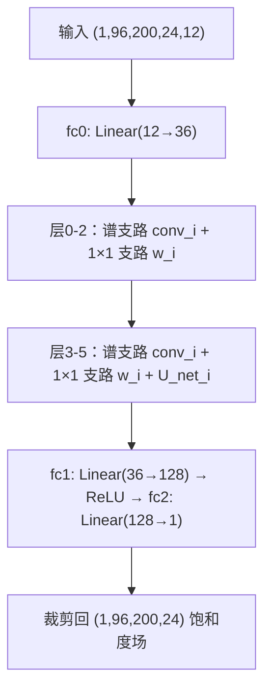

# U-FNO 模型讲解与答辩准备

> 定位：这份文档里的**每一个数字都是本机实测**（2026-10-30，RTX 3070 Laptop + `数据集/` 官方数据 + 官方 4500 样本权重），不是从论文转抄的。
> 用法：第 1–6 节用来"讲懂"，第 7–8 节用来"讲我们的贡献"，第 9 节是问答演练，第 10 节是现场演示脚本。
> 引用基线：Wen, G., Li, Z., Azizzadenesheli, K., Anandkumar, A., Benson, S. M. (2022). *U-FNO — An enhanced Fourier neural operator-based deep-learning model for multiphase flow.* Advances in Water Resources 163, 104180.

---

## 1. 30 秒口语版（答辩开场就背这段）

> CO₂ 封存能不能封住、什么时候会顶到盖层，要靠数值模拟回答；但一次两相流模拟要跑几十分钟到几小时，做不了成千上万次的参数敏感性分析和风险评估。
> 我们做的是**代理模型（surrogate）**：用神经网络直接学"地质参数场 → CO₂ 饱和度时空场"这个**算子映射**，一次推理 **0.2 秒**（本机 GPU 实测），比数值模拟快三个数量级以上。
> 模型选 **U-FNO**：它在 FNO（傅里叶神经算子）的谱变换之上加了 U-Net 局部支路，专门为多相流里"既有大尺度羽流、又有尖锐推进前沿"这种混合尺度问题设计。
> 我们的结果：**在官方 500 个测试样本上复现出平均相对 L2 误差 0.0647**，与官方权重训练目标一致；在此之上叠加不确定量化和风险分级。

**背下来这 5 个数**：33.10 M 参数 / 12 输入通道 / 500 测试样本 / rel L2 = 0.0647 / 单样本 0.2 s。

---

## 2. 项目在解决什么问题（物理 → 计算瓶颈）

| 环节 | 传统做法 | 瓶颈 | 代理模型 |
|---|---|---|---|
| 判断封存安全性 | 每个参数组合跑一次 TOUGHREACT/CMG 类两相流模拟 | 单次小时级，蒙特卡洛/敏感性分析跑不动 | 单次 0.2 s，可批量扫参 |
| 输入 | 渗透率场、孔隙度场、注入速率、温度压力、Swi、流度比… | — | 同一组 12 通道张量 |
| 输出 | 整段时间的饱和度/压力场 | — | 一颗 (96,200,24) 饱和度立方体 |

关键概念：**这不是"拟合一个曲线"，而是学一个算子** —— 输入是函数（参数场），输出也是函数（时空场）。FNO 系列的立身之本就是"在函数空间上学映射"，所以它天生适合 PDE 代理。

---

## 3. FNO 的核心思想（三步，答辩画图就画这三步）

```
v(x)  ──升维──  P₀: C_in→36   ──[ 谱支路 W + 局部支路 ]×6──  ──投影──  u(x)
```

一个 Fourier 层做两件事然后相加（对应代码 `x = x1 + x2`）：

1. **谱支路（全局）**：`rfftn` 变到频率域 → **只保留每个方向最低 10 个模态**（以及两个空间维的四个"角"区域，对应 4 个复数权重张量 `weights1..4`）→ 逐频率做一次通道间复数线性组合 `einsum("bixyz,ioxyz->boxyz")` → `irfftn` 变回物理空间。
2. **局部支路（1×1 卷积）**：`w_i = Conv1d(36,36,1)`，就是在物理空间按通道做的逐点线性变换，补谱支路丢掉的细节。
3. 过 ReLU，进下一层。

三个必须能答出来的要点：

- **为什么快/为什么省参数**：谱乘积是"每个频率一个矩阵"，FFT 本身 O(N log N)；参数量**与网格尺寸无关**，只与 `modes` 和 `width` 有关。这就是 FNO 的 discretization-invariance 来源。
- **为什么截断低频就够**：PDE 的解算子对高频是压缩的（解比输入光滑），保留带限模态近似积分算子；这也是"为什么不用 CNN 逐格点卷积"的答案——**一步 FFT 就有全局感受野**，CNN 要靠很深的堆叠才能传播远距离信息。
- **modes=10 的由来**：三个方向的格点数是 96 / 200 / 24，Nyquist 上限是 48 / 100 / 12；官方取 10（约为最低频带的 1/5），是论文里做过的权衡设置。答辩口径：**"10 是官方的模型设置，我们复现并核对了它；调大会显著增加参数量且易过拟合"**。

---

## 4. U-FNO 比 FNO 多了什么（我们这颗权重的真实结构）

`SimpleBlock3d` 共 **6 层**：**前 3 层是纯 Fourier 层，后 3 层每层额外并接一个 3 尺度 U-Net 支路**（代码 `x = x1 + x2 + x3`）。



- 加 U-Net 的动机（**这就是"U"的含义，也是答辩必问**）：FNO 截断高频 → 擅长光滑大尺度结构，**不擅长尖锐局部结构**；CO₂ 羽流恰好同时有"大尺度侧向铺展 + 盖层底面尖锐堆积 + 推进前沿"。U-Net 用 stride-2 下采样做**多尺度局部特征**、用跳跃拼接（`concat1/concat0`）把高分辨率细节带回来，作为**残差支路**加到谱支路上，而不是替换它。
- 我们的 `U_net(36,36,kernel=3,dropout=0)`：3 次 stride-2 下采样 + `ConvTranspose3d(k=4,s=2,p=1)` 上采样 + `BatchNorm3d` + `LeakyReLU(0.1)`，`dropout_rate=0`（官方设置，所以推理时不需要 dropout 采样）。

### 权重实测结构表（`torch.load` 后逐张量打印，共 156 个条目 / 33,097,829 参数）

| 模块 | 张量形状 | 作用 |
|---|---|---|
| `conv1.fc0` | (36, 12) | 12 个物理通道 → 36 维"潜通道"嵌入 |
| `conv1.conv0..5.weights1..4` | (36, 36, 10, 10, 10) `cfloat` | 6 个谱变换，各 4 个频率区域（低频块 + 三个高频角块） |
| `conv1.w0..w5` | (36, 36, 1) | 6 个 1×1 局部线性旁路 |
| `conv1.unet3/4/5.*` | 3D 卷积/反卷积/BN | 后 3 层的 U-Net 残差支路 |
| `conv1.fc1`,`conv1.fc2` | (128,36),(1,128) | 通道投影回 1 个输出通道 |

### 为什么先补边再裁剪（`Net3d.forward`，容易被追问）

`F.pad(..., "replicate")` 在水平和时间方向各补 8、再用常数 0 在垂深方向补 8，网格变 (104,208,32)；算完 `view` 后 `[..., :-8,:-8,:-8, :]` 裁回 (96,200,24)。两个理由：
1. **104=8×13、208=8×26、32=8×4** —— U-Net 有 3 级 stride-2 下采样，维度必须能被 8 整除；
2. FFT 隐含**周期性边界**，replicate 补齐能减弱边界跳变带来的谱伪影。

---

## 5. 数据：这颗模型到底吃什么（全部按元数据核对过）

**真实存储**（`data.pkl` 里的 `size/stride`，不是靠元素数猜的）：

| 文件 | size | stride | 结论 |
|---|---|---|---|
| `sg_test_a.pt` | (500, 96, 200, 24, 12) | (5529600, 57600, 288, 12, 1) | C 连续，可直接 reshape |
| `sg_test_u.pt` | (500, 96, 200, 24) | (460800, 200, **1**, **19200**) | **转置视图**！内存实际按 (时间, 垂深, 水平) 排布 |

> 这就是本轮最大的坑：按 `(96,200,24)` 直接 reshape 目标张量，等于把羽流"错位重排"，模型预测与它的相关性只有 **0.00**、rel L2 **2.8**；按真实 stride 还原后相关性 **0.993**、rel L2 **0.108**（单样本）。修复在 `repro/ufno/ufno_reader.py`（改为读 size/stride/storage_offset 后用 `as_strided` 还原）。

**轴与物理尺度**（官方 notebook 的换算式，已实测解码一致）：

| 轴 | 格数 | 物理范围 | 生成式 |
|---|---|---|---|
| dim0 垂深 | 96 | 0–200 m | `linspace(0,200,96)` |
| dim1 水平 | 200 | 约 3500 m，近井加密 | `dx = cumsum(3.5938 × 1.035012^i) + 0.1` |
| dim2 时间 | 24 | 约 30 年，指数加密 | `t = cumsum(1.421245^i)` 天 |

**12 个输入通道语义**（`SimpleBlock3d` 注释 + 实测数值范围核对）：

| 通道 | 含义 | 反演/范围（实测） |
|---|---|---|
| 0 / 1 | log 水平/垂向渗透率 | `kr = exp(ch × 15)` mD |
| 2 | 孔隙度 | 储层内约 0.05–0.35 |
| 3 | 注入位置（井点掩膜） | 仅井点位非零 |
| 4 | 注入速率 | `dnorm_inj(a) = (a×(3e6−3e5)+3e5)/(1e6/365×1000/1.862)` MT/yr |
| 5 | 温度 | `a×(180−30)+30` °C |
| 6 | 初始压力 | `a×(300−100)+100` bar |
| 7 | 束缚水饱和度 Swi | `a×0.2+0.1` |
| 8 | 流度比 λ | `a×0.4+0.3` |
| 9 / 10 / 11 | 水平/垂向网格步长、时间步长 | 实测 200 / 96 / 24 个唯一值，与上表公式吻合 |

**`mask` 是什么（务必答对）**：`mask = (ch0 != 0) at t=0`，即"这块地质层是不是参与流动的储层格点"。实测样本 0 是 **52/96 行 × 全部 200 列 = 10,400/19,200 ≈ 54%** 的格点参与计算，非储层（盖板等）在数据生成时就被置零。它**不是**盖层/断层的地质边界，更不是井筒几何 —— 这一点直接决定了我们风险模型的口径（见第 7 节）。

---

## 6. 评价指标与复现结果

**指标定义**（和官方 notebook 一致，别自己发明）：

$$\text{rel L2} = \frac{\lVert \hat u_{\text{mask}} - u_{\text{mask}} \rVert_2}{\lVert u_{\text{mask}} \rVert_2}$$

- 用 `LpLoss(size_average=False)` 求和后再对样本取**均值**；
- 只在 mask 内的格点上算（不同样本储层厚度不同，展平后长度可变）；
- **不能除以 460800**（那是全网格数，会把相对误差变成一个没有物理含义的绝对量）。

**本机复现结果（官方 4500 样本权重 + 500 个测试样本推理，不训练）**：

| 指标 | 实测值 |
|---|---|
| mean rel L2 | **0.0647** |
| median / p10 / p90 | 0.0543 / 0.0307 / 0.1093 |
| 最差样本 | 0.3276 |
| 单样本耗时 | GPU 0.21 s（CPU 9.0 s，约 43×） |
| 500 样本总耗时 | **97.5 s** |
| 显存峰值（batch=1） | 1406 MiB / 8192 MiB |

对照实验（用来证明"管线本身没错"）：
- **随机初始化**同结构模型：rel L2 ≈ 1.0–1.2（未训练就该接近 1）；
- **目标张量按 C 序误读**：rel L2 ≈ 2.8、相关性 0.00；
- **修正 stride 后**：rel L2 = 0.0647、相关性 0.99。
> 这三行是答辩时最有说服力的"验证链"：说明我们的 0.0647 不是碰巧，而是每一步都被反向验证过。

---

## 7. 我们自己的东西（创新点必须这样讲）

1. **复现本身**：把官方 notebook 转写成可复跑的 `.py` 管线（`repro/ufno/eval_ufno_gas_saturation.py`），并在**无 GPU 依赖训练**的前提下完成 500 样本推理复现，指标 0.0647。
2. **数据读取层的两个真实缺陷修复**（这是工程贡献，讲成"验证链"而不是"改了个 bug"）：
   - `torch.load(mmap=True)` 在 Windows + torch 2.15 上一访问就 **Segfault(139)** → 自写按 zip 偏移的分页直读 `ufno_reader.py`，11 GB 张量在 15.8 GB 内存机器上可逐样本访问；
   - 输出张量是**非连续转置视图**，朴素 reshape 会让复现指标从 0.06 变成 2.8 → 改为按 `size/stride/storage_offset` 还原。顺带查清 `sg_val_u.pt`（9.2 GB）里 `storage_offset=4500×460800`，前 8.29 GB 是 train 输出、尾 921 MB 才是 500 个 val 输出 —— 之前"val 有 5000 个样本"的猜测是错的。
3. **不确定量化（UQ）——已实现，路线是"输入侧参数扰动 + 保形校准"，不是深度集成**：
   - **为什么不是集成**：官方只放 1 组权重，K 个成员必须自训，而训练集 99.5 GB 本机放不下 → 集成在"复现"约束下不可行。要主动讲这个取舍，不要含糊过去。
   - **改成了什么**：① 对输入通道的地质参数（渗透率、孔隙度、注气速率、Swi、流度比）加**空间相关**噪声（相关长度 8 格，不是白噪；渗透率/孔隙度用同一张 (H,W) 图，注气速率用一条 (T,) 曲线），K=8 副本推理取逐格 std → 这是**输入侧（地质非均质性）**的不确定性；② 模型侧的可信度用**保形（split conformal, Lei et al. 2018）**补：在校准子集上选放大系数 κ，在**没参与选 κ** 的验证子集上报覆盖率，所以 PICP 是"兑现的"而不是"自报的"。
   - **实测（500 场地全测试集 × 8 副本，α=0.10，校准/验证 300/200 留出划分）**：交付口径 κ=**1.24**，羽流内格点 PICP=**0.911**（承诺 ≥0.90，校准集上 0.898）、MPIW=0.093；κ=1（不校准）时羽流内只有 **0.868** → 参数扰动 std 确实低估真实误差，保形放大是必需的。这条管线自己算出的 500 样本 rel L2 = **0.0647**，与第 6 节 `eval_ufno_gas_saturation.py` 独立跑出的数字一致——管线自校验通过。
   - **可靠性不是只在 α=0.10 这一档碰巧兑现**：把"承诺覆盖率"当横轴扫 **8 档**（0.50→0.99），每档重新在校准子集上选 κ、都在留出 200 场地上兑现：**0.51 / 0.61 / 0.71 / 0.81 / 0.86 / 0.91 / 0.96 / 0.99**，最大偏差 **1.2 个百分点**（图 7a）。代价曲线（图 7b）：κ 从 1.24 涨到 3.90、MPIW 从 0.093 涨到 0.292（**3.1 倍**）→ 选 0.90 是"敢承诺且区间还有决策价值"的折中。逐场地看（`picp_site`）均值 0.903、p10 0.779，**12.4% 的场地低于 0.80** → **队列兑现 ≠ 每个场地兑现**，这句要主动说。
   - **坑一「干格点稀释」（必须会讲）**：储层掩膜内只有 **15.4%** 的格点真含 CO₂，其余是"真值 0、模型也≈0"的干格点。拿全部格点选 κ 只得到 **0.18**，全格点 PICP=0.896 看着达标，**羽流内覆盖却只有 0.366**。区间是给羽流兜底的，所以口径要换成"只在羽流内校准"→ κ=1.24、覆盖兑现 0.911。同一批数据、同一个 α，两个口径的结论差 2.5 倍，这就是为什么报告里必须同时列 PICP **和** MPIW **和** 口径定义（`field_band.variants` 三行全在 JSON 里）。
   - **坑二「中心不能用 MC 均值」**：用 8 个扰动副本的均值当预测中心，rel L2 从 **0.0647 涨到 0.0954**。扰动副本是用来估离散度的，预测值仍然用未扰动的那一次。
   - **严格口径 vs 边际口径**：要求"每个场地各自达标"的最小 κ=**8.75**，羽流内覆盖 0.998 但 MPIW=**0.656**（区间宽到没有决策价值）。两个都报，选哪个是设计决定，不是隐瞒。

4. **风险三级预警——从"绝对几何阈值"改成"跨样本相对分位 + 区间判级 + 可信度降级"**：
   - **旧口径为什么废**：绝对"前锋距顶多少米"实测 **69.1% 的帧 gap=0、97.0% 的样本至少一帧顶到上界**（储层占网格顶部 52/96 行，模型上边界就在 0 m 深度）→ 判据没有区分力。数据里也没有井位/断层几何，机制 2、3 无法取证。
   - **三根风险轴**（全部先换成**真值队列里的分位**再加权，权重自动归一）：突破时间 0.45（越早越差，真值队列 500 个场地：p50=**31.3 d**、min=1.0 d、max=10 950 d、**2.4% 从未突破**）、末帧羽流面积比 0.35（p50=**0.374** / max=0.575）、贴左右边界列的格点占比 0.20（p50=**0.128** / max=0.316）。
   - **红线/黄线也必须是队列分位**：综合分是三个分位的加权和，它**不**均匀分布在 [0,1] —— 实测 500 场地只落在 **0.114–0.826**（p50 0.515），按"绝对值 ≥0.90"判红线永远没人能过，三级静默退化成两级。这是实现过程中发现并修掉的 bug（`RiskReference.score_percentile`）；根因是各轴高度相关且突破时间在 1.0 d 处有 **29.5%** 的并列（第一个输出时刻就顶到上界）——这句话要连"体检"一起讲：`axis_diagnostics` 里并列占比就是这根轴区分力的自测。
   - **区间判级**：每个指标的保形半径 ±q（实测 breakthrough q=**277 d**、areal q=**0.0137**、lateral q=**0.0269**，留出验证集覆盖 **0.93 / 0.92 / 0.895**）映到队列分位得 [lo, hi]，**整条区间都在阈值同侧才给确定档**，跨线一律判黄。黄档的意思是"**模型说不准**"，不是"风险中等"。
   - **可信度降级**：掩膜外伪影占比、饱和度越界幅度处于队列前 10% → **不得判绿**。这两个量是"模型在无监督区域乱画"的指示量，**不是泄漏证据**（真值场在掩膜外恒为 0，所以参照队列必须用预测队列；用真值队列会因分布退化而永不触发）。
   - **最终实测结论（本项目最重要的一句话，答辩要落在这一行）**：500 个场地，真值上帝视角判级 {绿 375 / 黄 75 / 红 50}；用预测做点判级 {**328 / 105 / 67**}，与真值一致率 **84.4%**、综合分 Spearman **0.984**（换 5 组权重最差仍 **0.954** → 排序不是权重拍出来的）；**但一旦把区间兑现到 90% 覆盖，判级变成 {165 / 335 / 0}，确定档只剩 33%、红档 0 个**。也就是说：**当前代理模型的精度足以做封存风险的筛查排序，不足以在单个场地下红/绿结论**——这不是失败，这就是 UQ 该给出的答案。
   - **错判的"形状"（图 9 混淆矩阵）**：点判级的 84.4% 一致率里，**绿、红互错 0 个**——错全在相邻档（真值绿被误判黄 52 个、真值黄被判绿 5 个、真值红被判黄 2 个）；区间口径下 500 个场地**没有一个被判红**，真值红档 50 个 100% 落到"黄=说不准"。这两句话合起来就是产品定位：**排序筛查 + 提示复核**，不是"给单个场地盖红章"。

---

## 8. 讲不出彩也别说错的红线

- 别说"我们训练了 U-FNO"——**我们做的是官方权重复现 + 下游 UQ/风险**。
- 别说"mask 是盖层边界"——它是**有效储层格点掩膜（绘图/训练裁剪用）**。
- 别说"FNO 完全不需要数据"——它需要高保真数值解做训练标签，我们的标签来自官方 4500 样本数据集。
- 别把 0.0647 说成"优于论文"——我们没有在同一数据上跑 CNNO/FNO 基线，只能说"与官方权重的复现一致"。
- 数据集来源与许可要能一口报出：GitHub `gegewen/ufno` README 里的公开 Drive 数据（4500/500/500 划分），**具体许可条款答辩前核对一次 README 原文**。

---

## 9. 问答演练（17 问，按被问概率排序）

| # | 问题 | 30 秒答法 |
|---|---|---|
| 1 | 为什么不直接用数值模拟？ | 单次小时级 vs 0.2 s；风险/敏感性分析要成千上万次采样，只有代理模型撑得住。 |
| 2 | FNO 和 CNN 的本质区别？ | CNN 在物理空间做局部卷积、感受野靠堆叠；FNO 在**频率空间**做全局矩阵乘，一步覆盖全域，且参数与网格分辨率解耦。 |
| 3 | U-FNO 的"U"带来什么？ | 后 3 层并接 3 尺度 U-Net 残差支路，补回谱截断丢掉的**尖锐局部结构**（盖层底面堆积、推进前沿）。 |
| 4 | 为什么截断到 10 个模态？ | 解算子对高频压缩；10 ≈ 各方向 Nyquist(48/100/12) 的 1/5，是官方的权衡设置；调大更贵、易过拟合。 |
| 5 | 换分辨率还能用吗？ | 原理上 FNO 离散化无关；但我们的实现按 (96,200,24) 写死了补边/裁剪，跨分辨率需重设并重新验证。 |
| 6 | 输入 12 通道都有物理意义吗？ | 有，能逐个反演（`kr=exp(ch×15)`、`dnorm_inj` 等，我背两张：渗透率/孔隙度/注入速率/温度/压力/Swi/流度比/网格三步长）。 |
| 7 | 输出为什么只有一个通道？ | 该权重是气相饱和度模型（另有压力模型）；末端 `fc2: Linear(128→1)`，所以一颗 (96,200,24) 的饱和度场。 |
| 8 | 0.0647 说明什么？ | mask 内相对 L2 平均 6.5%；未训练约 1.0、误读数据 2.8 —— 量级差说明复现有效；但要与 CNNO/FNO 基线比才谈"更准"。 |
| 9 | mask 怎么定的？ | `ch0≠0 @ t=0`，实测样本 0 为**顶部 52/96 行 × 200 列 ≈ 54%** 格点；它标的是"参与流动的储层行"，非储层在数据生成时被置零。 |
| 10 | 不确定性怎么量化？ | 两条腿：**输入侧**对地质参数（渗透率/孔隙度/注气速率/Swi/流度比）加空间相关噪声跑 8 副本取逐格 std；**模型侧**用 split conformal 选放大系数 κ，并**在没参与选 κ 的验证子集上**报 PICP。实测（500 场地）κ=**1.24** 时羽流内 PICP=**0.911**（承诺 0.90）、MPIW=0.093。为什么不用深度集成：官方只放 1 组权重、训练集 99.5 GB 本机放不下，集成必须自训 → 路线改成"输入侧 MC + 保形校准"，这是**取舍**不是偷懒。 |
| 11 | 风险分级怎么用？ | 三根相对轴（突破时间 0.45 / 面积比 0.35 / 侧向铺展 0.20）先转成**真值队列分位**再加权，红=队列前 10%、黄=前 25%；再用保形半径把点判级变区间判级——**跨阈值线一律判黄**（黄=模型说不准）。实测（500 场地）：点判级与真值一致率 **84.4%**、Spearman **0.984**；**区间口径下确定档只剩 33%、红档 0 个** → 结论是"够做筛查排序，不够给单个场地下红/绿结论"。绝对"距盖层多少米"已被实测推翻（69% 帧 gap=0），不要用。 |
| 12 | 为什么不做井泄漏/断层活化？ | 这套公开数据只有储层参数场和饱和度场，没有井筒轨迹/断层几何/应力，**不具备直接证据**；列为后续工作。 |
| 13 | 你复现中最难的点？ | 讲 stride 那一条：11 GB 张量 mmap 段错误 → 偏移直读；再做指标发现相关性 0 → 追到 `data.pkl` 的 stride 元数据。 |
| 14 | 算力从哪来？ | 本机 RTX 3070 Laptop 8 GB；batch=1 显存峰值 1.4 GB，500 样本 97.5 s；推理不需要集群。 |
| 15 | 你的贡献与论文的关系？ | 论文给方法与权重；我们给出**可复跑管线 + 指标复现 + 面向封存风险的不确定性与分级框架**，并纠正了数据侧两个会导致复现失败的错误。 |
| 16 | 你的覆盖率是不是自己给自己打分？ | 不是。选 κ 用校准子集（**300 个场地**），报 PICP 用**另一批**没参与选 κ 的验证子集（**200 个场地**），这是 split conformal 的标准做法；理论保证只需要"样本可交换"，不需要模型正确。校准集上 PICP=0.898、留出集上 0.911，两个数都写在 `field_band` 里。可复现的证据：同一批数据里 κ=1 时羽流内只有 **0.868**，κ=**1.24** 才到 **0.911** —— 校准是真的在补偿低估。 |
| 17 | 为什么区间口径下一个红档都没有？ | 因为指标半径比档位间隔还宽：突破时间的保形半径 q=**277 d**，而队列里前 10% 与前 25% 的间隔折到时间上不到这个量级。**这就是正确答案**：模型误差大到不足以支撑"这个场地一定危险"的结论。要收窄只需更多副本/更准的模型或改做群体筛查（我们把它定位成筛查排序）。红线一个都不给 ≠ 方法失效，是 UQ 在起作用。 |
| 18 | 0.911 会不会只是 0.90 这一档碰巧兑现？ | 不是。我们把"承诺覆盖率"当横轴扫了 **8 档**（0.50/0.60/0.70/0.80/0.85/0.90/0.95/0.99），每档重新在校准子集上选 κ、在留出集上兑现：**0.51 / 0.61 / 0.71 / 0.81 / 0.86 / 0.91 / 0.96 / 0.99**，最大偏差 **1.2 个百分点**（图 7a）。代价曲线也一起给（图 7b）：想从 0.90 提到 0.99，κ 从 1.24 涨到 3.90、区间宽度 MPIW 从 0.093 涨到 0.292（**3.1 倍**）—— 所以我们选 0.90 而不是更敢说的数字。诚实的边界：这是**队列级**兑现，逐场地看仍有 **12.4%** 的场地羽流内覆盖低于 0.80（`picp_site`）。 |

---

## 10. 现场演示脚本（3 分钟，全部在本机 GPU 上跑）
```bash
# ① 复现指标（97.5 s，边跑边讲）
.venv/Scripts/python.exe repro/ufno/eval_ufno_gas_saturation.py \
  --model_path 数据集/sg_UFNO_4500_trained.pt --data_dir 数据集 \
  --device auto --metrics_out experiments/ufno_metrics.json

# ② 导出预测场给风险模型（约 1 分钟）
.venv/Scripts/python.exe repro/ufno/eval_ufno_gas_saturation.py \
  --model_path 数据集/sg_UFNO_4500_trained.pt --data_dir 数据集 \
  --device auto --limit 100 --save_npz experiments/ufno_pred.npz

# ③ 风险时间线 + 阈值校准（秒级）
.venv/Scripts/python.exe src/risk_model_demo.py \
  --npz experiments/ufno_pred.npz --pt_key pred --mode calibrate

# ④ 新口径逐场地判级：把"为什么判这一档"的理由打在屏幕上（秒级）
.venv/Scripts/python.exe src/risk_model_demo.py \
  --npz experiments/ufno_pred.npz --mode tier --limit 20 --sample 3

# ⑤ UQ + 三级预警一条龙：推理→参数扰动→保形校准→区间判级 + 8 档可靠性扫描（100 场地≈8 分钟，500 场地≈41 分钟）
.venv/Scripts/python.exe tools/run_uq_risk.py \
  --model_path 数据集/sg_UFNO_4500_trained.pt --data_dir 数据集 \
  --limit 100 --replicas 8 --alpha 0.10 \
  --out_json experiments/ufno_uq_report.json --out_csv experiments/ufno_uq_tiers.csv

# ⑥ 算力/显存证据（10 秒）
.venv/Scripts/python.exe tools/bench_gpu_inference.py --data_dir 数据集 --device cuda

# ⑦ 出图（纯 CPU，只读 ⑤ 的产物，不需要 GPU/权重；改标题、换配色、换场地都跑这一条）
.venv/Scripts/python.exe tools/make_figures.py \
  --report experiments/ufno_uq_report_500.json --csv experiments/ufno_uq_tiers_500.csv \
  --npz experiments/ufno_uq_500.npz --outdir results/ufno_uq --band-site 0

# ⑧ 演示网页（①~⑤ 页纯 CPU，只读 json/csv/npz + 上面那批图；⑥ 参数沙盘要权重与数据集，共 6 页）
.venv/Scripts/python.exe -m streamlit run src/app/streamlit_app.py
```

**答辩用的正式数字已经在 `experiments/ufno_uq_report_500.json`（500 场地全测试集，seed 20261030），不用现场重跑。**
**若时间紧改用 `--limit 100` 现场跑（≈8 分钟）**，屏幕上是 κ=**1.40**、羽流内 PICP=**0.921**、区间判级 {28/72/0}、确定档 **28%**、点判级一致率 **85%** —— 与 500 场地口径只差样本量，结论方向完全一致（`experiments/ufno_uq_report.json` 就是这份快速产物）。**数字要连着样本量一起念**，别把 100 场地的 0.921 说成正式结果。

**如果只能演示一件事**，演示 ①：`mean_rel_L2=0.0647` 直接打在屏幕上，比任何 PPT 都有说服力。
**如果要展示"我们自己的东西"**，直接打开 `experiments/ufno_uq_report_500.json` 讲两行：`field_band.picp_eval = 0.911`（承诺 0.90，覆盖是兑现的）和 `tiers.decisive_share_interval = 0.33`（区间口径下确定档只剩 33%）——前者证明 UQ 可信，后者证明我们敢说自己模型的结论有多强。

## 11. 图表清单（PPT 直接用，全部是真实数据出的图，不是框图）

产物在 `results/ufno_uq/`，由 ⑦ 一条命令重生成；每张图的标题里就把数字写死了，截图即可用。

| 图 | 文件 | 讲什么 | 图上直接能读到的数字 |
|---|---|---|---|
| 图 1 | `fig1_scatter_pred_vs_truth.png` | 预测 vs 真值：综合分（带 90% 区间误差棒）+ 三根风险轴（面积比 / 突破时间 log-log / 侧向占比）四联散点 | 各轴 Spearman ρ、综合分 ρ=0.984、一致率 84.4% |
| 图 2 | `fig2_residual_distribution.png` | 残差体检四联：逐场地 rel L2 分布、标准化残差（±8 截尾）、\|残差\|随饱和度分箱、场地 0 末帧残差剖面 | 均值 0.0647 / 中位 / p90、尾部 0.63%、**真值<0.01 的干格点占掩膜 89%**（注意与图 5 的"预测羽流占 15.4%"是两个口径：一个按真值分箱，一个按预测>阈值取羽流） |
| 图 3 | `fig3_interval_spans.png` | **核心诚实结论那张**：500 个场地的区间跨度按大小排开，跨过黄/红分位线的就是"判不死"的 | 确定档 33%、黄档占比、跨度中位数 |
| 图 4 | `fig4_tier_compare.png` | 三种判级口径同框：真值口径 / 点判 / 区间判的三档堆叠柱 + 四种 κ 的 PICP 对比 | {375/75/50} vs {328/105/67} vs {165/335/0}、κ=1/0.18/1.24/8.75 的覆盖率 |
| 图 5 | `fig5_band_coverage_site0.png` | 逐格区间带四联：真值场 / 预测场 / κ·max(std,min_band) 带宽 / 羽流内是否被覆盖 | 羽流只占储层掩膜 15.4%、本帧羽流内 78.7% vs 全储层 91.3%、留出集 PICP=0.911 |
| 图 6 | `fig6_timeline_axes.png` | 时间轴：三个场地面积比演化 + 区间（用**指标级**保形半径，不是逐格带）；右联各轴区分力体检 | q_areal=0.0137、并列率 / NaN 率 |
| 图 7 | `fig7_reliability.png` | 可靠性曲线（左）：8 档承诺 vs 留出集兑现；代价曲线（右）：MPIW 与 κ 随承诺等级上升 | 实测 0.51/0.61/0.71/0.81/0.86/0.91/0.96/0.99，最大偏差 1.2%；0.90→0.99 时 MPIW 0.093→0.292（3.1 倍）、κ 1.24→3.90；逐场地 12.4% 低于 0.80 |
| 图 8 | `fig8_field_evolution_site0.png` | 羽流随时间演化的 6 帧切片（上排真值 / 下排预测，同一色标）+ 逐帧 rel L2 曲线 + 面积比对照 | 该场地整场 rel L2=0.1082、误差峰值第 13 帧 0.140、队列均值 0.0647 |
| 图 9 | `fig9_tier_confusion.png` | 判级混淆矩阵（真值 oracle 为行）：左=点判级 右=区间判级 | 一致率 84.4% / 48.0%、**绿红互错 0 个**、真值红档 50 个在区间口径下 100% 落到"黄=说不准" |

**答辩讲图的顺序建议**：图 8（先看物理现象，羽流真的被画出来了）→ 图 1（准不准）→ 图 2（误差长什么样）→ 图 5（逐格区间带是实心的，不是嘴上说说）→ 图 7（覆盖率兑现）→ 图 3 + 图 4（我们敢说自己只能做筛查）→ 图 9（错判全在相邻档、从不误报红档，所以定位是"筛查 + 提示复核"）。

**三条必须一起说的图注**（否则会被追问）：
- 图 5 的 **91.3%** 是"全储层格点"口径，被 89% 的干格点稀释；交付口径是**羽流内** PICP=**0.911**（留出集队列级）。别说成"91% 的格子都覆盖了所以很好"。
- 图 6 / 图 8d 的区间用的是指标级半径 q_areal，**不是**把逐格 band 直接 propagate 过去——后者因为 `min_band(0.01) ≈ sat_thr(0.01)` 会退化成"整条曲线从 0 冲到 1"，脚本里已改成正确口径并在标题注明。
- 图 8 有两个 rel L2：标题里的 **0.1082** 是该场地"24 帧合起来算"（与判级表同口径），8c 曲线是**逐帧**算的（均值 0.104、峰值 0.140）——别把两者当同一个数互相打脸。

> 图 7 需要报告里有 `reliability` 块（`tools/run_uq_risk.py` 已输出）。旧 json 没这个键时脚本会跳过图 7 并打一行提示，重跑一次 ⑤ 即可。
